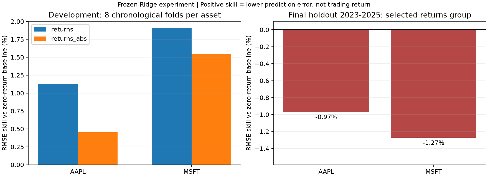

# StockForecasting

Dự án học và phát triển kỹ thuật dự báo chuỗi thời gian, kế thừa
[Quant Forecast Lab](https://github.com/JordiCorbilla/stock-prediction-deep-neural-learning)
của Jordi Corbilla. Mã nguồn hiện nằm trực tiếp tại Git root
`D:\Github\StockForecasting`; metadata kế thừa khai báo phiên bản 2.1.0.
Chưa xác định upstream commit.

Giữ nguyên [LICENSE Apache-2.0 của upstream](LICENSE)
và [CITATION](CITATION.cff).
Các kết quả lịch sử trong tài liệu upstream chưa được tái lập ở workspace này.

Phiên bản phát triển hiện có pipeline nghiên cứu offline và walk-forward:
CSV một tài sản → kiểm tra dữ liệu → chia theo thời gian →
ADF/KPSS và ACF/PACF trên training → thử lookback/Ridge alpha →
chọn bằng validation → so sánh nhóm feature trên development folds →
chấm final holdout → lưu artifact và nạp lại để dự báo.

Bằng chứng, quyết định và công việc còn lại:
[Engineering review](docs/ENGINEERING_REVIEW.md).
Các lệnh LSTM kế thừa được lưu trong [Upstream guide](docs/UPSTREAM_GUIDE.md).
Giải thích từ dữ liệu, thuật ngữ đến quyết định và bài tập:
[Learning guide](docs/LEARNING_GUIDE.md).

## Cấu trúc dự án

~~~text
StockForecasting/               # Git root: chạy lệnh tại đây
├── quant_forecast_lab/         # Thư viện nghiên cứu và CLI
├── tests/                      # Test nhẹ và offline integration tests
├── tests_runtime/              # Test cần TensorFlow và model mẫu
├── benchmarks/                 # Script và kết quả benchmark kế thừa
├── examples/                   # Notebook và reference model đang được dùng
├── docs/                       # Kiến trúc, phương pháp, audit, hướng dẫn gốc
├── log/                        # Kết quả chạy và hồ sơ di chuyển; Git ignore
├── .github/                    # CI và mẫu issue/PR
├── stock_prediction_*.py       # Entry points LSTM kế thừa, giữ tên tương thích
├── pyproject.toml              # Khai báo package và dependency chính
├── constraints-win-py312.txt   # Phiên bản dependency đã xác minh trên Windows
├── requirements.txt            # Cài package từ pyproject.toml
├── environment.yml             # Tạo Python 3.12 bằng Conda nếu sử dụng
├── LICENSE / CITATION.cff      # Giấy phép và ghi nhận nguồn
└── README.md                   # Hướng dẫn hiện tại
~~~

## Chạy từ source trên PowerShell

Runtime đầy đủ của upstream yêu cầu Python 3.11 hoặc 3.12 và
TensorFlow 2.18.1. Đã tạo môi trường riêng `.venv/runtime312` và xác minh
Python 3.12.16 / TensorFlow 2.18.1 trên CPU: **109 tests đạt**, gồm runtime tests.
V1/v6/v9 cũng đã chạy một bước tối ưu hóa thật và kiểm tra lưu/nạp artifact;
đây chưa phải huấn luyện hay tái lập benchmark thị trường của LSTM upstream.

Trong workspace hiện tại, chạy từ Git root:

~~~powershell
.\.venv\runtime312\Scripts\python.exe -m pytest -q -o addopts= tests tests_runtime
.\.venv\runtime312\Scripts\python.exe -m quant_forecast_lab.cli experiment --synthetic --asset SYNTHETIC
~~~

Để tạo lại trên Windows khi đã có Python 3.12 hệ thống, dùng
`py -3.12 -m venv .venv/runtime312`, rồi cài bằng Python của môi trường đó:
`python -m pip install -r requirements.txt -c constraints-win-py312.txt`.
File constraints ghi phiên bản đã kiểm chứng, không phải lockfile đa nền tảng
hay có hash. Python được tải local ở `log/toolchains` trong workspace hiện tại;
không xóa thư mục này khi còn dùng môi trường dựa trên nó.

Nếu chỉ cần phần offline, cài stack nhẹ trong môi trường riêng:

~~~powershell
python -m pip install numpy pandas scikit-learn matplotlib "statsmodels>=0.14,<0.16" pytest ruff
~~~

Các lệnh `python -m quant_forecast_lab.cli ...` bên dưới chạy trực tiếp từ
`D:\Github\StockForecasting`. Chúng không cần cài package editable hoặc tải
dữ liệu mạng khi chạy từ source.

## Dữ liệu và protocol

CSV cần hai cột `Date,Close`, một tài sản, ít nhất 60 quan sát,
ngày duy nhất theo thứ tự tăng và giá dương/hữu hạn. Ví dụ schema:

~~~csv
Date,Close
2024-01-02,100.0
2024-01-03,101.0
~~~

Hai dòng minh họa chưa đủ để chạy. Không tự sắp xếp, fill hoặc
loại dòng thiếu để làm dữ liệu hợp lệ. Lag tính theo quan sát đầu vào;
chưa xác minh lịch sàn, corporate actions hoặc point-in-time correctness.

Với snapshot có sẵn:

~~~powershell
python -m quant_forecast_lab.cli experiment --csv path\to\close.csv --asset AAPL --data-kind market --lookbacks 1 5 10 --ridge-alphas 1 10
~~~

`--data-kind market` là mô tả nguồn do người cung cấp xác nhận,
không phải chứng nhận dữ liệu của chương trình.

Mặc định chia 60% training, 20% validation, 20% final test.
Các ứng viên dùng chung target timestamps; StandardScaler chỉ fit training.
Validation chọn cấu hình Ridge. Không refit; final test không chọn tham số.
Baseline return bằng 0 tương ứng giữ nguyên giá gần nhất.

ACF/PACF ghi ứng viên và interval theo từng lag; chúng không tự quyết định
lookback hoặc hyperparameters. Hai nhóm hiện hỗ trợ là `returns` (L biến)
và `returns_abs` (2L biến gồm return và trị tuyệt đối của cùng các return).
Chưa thêm nhóm technical/macro hoặc volume.

## Walk-forward và thí nghiệm thị trường

Smoke walk-forward không cần mạng hoặc TensorFlow:

~~~powershell
python -m quant_forecast_lab.cli walk-forward --synthetic --asset SYNTHETIC --lookbacks 1 3 --ridge-alphas 1 --max-analysis-lag 5 --min-train-size 80 --validation-size 20 --test-size 60
~~~

Mỗi development fold có training, inner validation và phần chấm ngoài mẫu.
Validation chọn lookback/alpha; các development folds chọn nhóm feature.
Final holdout được chấm sau đó, không refit và không dùng để tuning.
Mỗi child run có scaler, diagnostics, trial log và model riêng. Các target được
chấm không chồng lấn giữa fold, các nhóm được so sánh trên cùng thời điểm.

Thu thập dữ liệu là lệnh riêng, có truy cập mạng và cần yfinance:

~~~powershell
python -m quant_forecast_lab.cli acquire --asset AAPL --start 2015-01-01 --end 2026-01-01
~~~

`--end` là ngày kết thúc exclusive. Snapshot lưu giá điều chỉnh, bản vendor,
tùy chọn tải và checksum. Chưa xác minh point-in-time hoặc tính đầy đủ lịch sàn.
Không dùng giá điều chỉnh này như giá có thể khớp lệnh thực tế.

Protocol đã khóa trước thí nghiệm:
[return_history_ablation.json](benchmarks/protocols/return_history_ablation.json).
Tái chạy từ các snapshot local hiện có, không tải lại:

~~~powershell
.\.venv\runtime312\Scripts\python.exe benchmarks\run_reference_research.py --snapshots log\validation_20261112\market_snapshots.json
~~~

File mapping JSON chứa tên mã → thư mục snapshot do `acquire` tạo. Nó và dữ liệu
raw được Git ignore; clone mới phải cung cấp snapshot/mapping riêng. Tải lại
vendor có thể thay đổi giá lịch sử, nên muốn tái lập đúng phải giữ CSV gốc.

Kết quả ngày 12/11/2026: 8 development folds/mã, tổng 204 trial; final holdout
03/01/2023–31/12/2025 có 752 target/mã. Nhóm `returns_abs` không cải thiện
development so với `returns`; cả hai model cuối kém baseline zero return:

| Mã | Lookback / alpha cuối | Final RMSE log-return | Baseline RMSE | RMSE skill |
| --- | --- | --- | --- | --- |
| AAPL | 5 / 1 | 0.01625835 | 0.01610225 | -0.9694% |
| MSFT | 1 / 10 | 0.01475966 | 0.01457421 | -1.2724% |

`skill = 1 - RMSE_model/RMSE_baseline`; số âm nghĩa model có sai số lớn hơn.
Không promote model hoặc tuning lại từ final holdout đã xem. Hai mã được chọn
trước, không đại diện toàn thị trường; chưa kiểm định ý nghĩa thống kê.
Số liệu, provenance và giới hạn: [measured report](benchmarks/results/2026-11-12-reference-ridge.json).

## Log và artifact

Mỗi run tạo `log/ridge_log_return/<run_id>/`, được Git ignore:

- `manifest.json`, `config.json`, `environment.json`: trạng thái, cấu hình,
  phiên bản, source hash và artifact checksums.
- `input_snapshot.csv`, `data_manifest.json`, `split_manifest.json`:
  dữ liệu thực dùng và ranh giới đánh giá.
- `analysis/ACF_PACF_Analysis_<date>.txt`, `z_table_<date>.txt`,
  `stationary_test.txt`, CSV/JSON và hình ACF/PACF.
- `model_summary.txt`, `trials.csv`, `artifacts/model.json`:
  cấu hình được chọn, các trial đã chạy và tham số model/scaler.
- `predictions.csv`, `metrics.json`, `residual_diagnostics.json`:
  kết quả ngoài mẫu và chẩn đoán.
- `future_forecast.json`, `forecast_values.txt`, `figures/forecast.png`,
  `summary.md` và `run.log`.

Artifact JSON được nạp lại và đối chiếu dự báo ở mọi test origin.
Dự báo tương lai chưa có actual và chưa đoán ngày giao dịch kế tiếp.
Run thất bại giữ traceback và trạng thái failed.

Run walk-forward ở `log/walk_forward_ridge/<run_id>/` có `selection.json`,
`fold_metrics.csv`, development/final predictions và thư mục child runs.
Runner protocol tổng lưu ở `log/market_protocol/<run_id>/`; manifest tổng bao
gồm checksum manifest con. Báo cáo đã kiểm tra 37 manifest và 2.783 lượt checksum.

Dữ liệu tổng hợp dùng kiểm tra kỹ thuật; kết quả thị trường được gắn nhãn riêng.
Thí nghiệm mới chưa chứng minh lợi thế trên final holdout hoặc khả năng sinh lợi.
Runner chưa có calibrated uncertainty, trading execution hoặc deployment.

## Kiểm tra chất lượng và học tập

~~~powershell
python -m pytest -q tests
ruff check quant_forecast_lab tests tests_runtime
python -m compileall -q quant_forecast_lab
python -m quant_forecast_lab.cli --help
~~~

`tests_runtime` cần đầy đủ TensorFlow và fixture; test nhẹ không thay thế
việc chạy bộ này. Bộ runtime local đã đạt, nhưng scaler reference có cảnh báo
khác phiên bản scikit-learn; chưa tuyên bố tái lập chính xác kết quả upstream.
Workflow ở Git root kiểm tra phần offline trên Python 3.12; hosted GitHub Actions
vẫn chưa được xác minh trong phiên này và reference fixtures chưa nằm trong Git.

Phần kế thừa gồm kiến trúc LSTM, data/training scripts, evaluation utilities
và các thí nghiệm lịch sử. Phần phát triển tại workspace này gồm sửa lỗi
đánh giá/drawdown/uncertainty/khôi phục giá/checkpoint, training diagnostics,
vòng đời run, walk-forward, snapshot provenance và ablation có kiểm tra leakage.
Chưa tuyên bố tính mới nghiên cứu hoặc mức sẵn sàng production.

Bài tập người học: dùng một chuỗi sáu mức giá để tính tay hai return inputs
và next-return target; đối chiếu `return_windows` và
`tests/test_research.py::test_window_targets_and_origin_history_are_aligned`.
Sau đó giải thích vì sao thay đổi final test không được làm đổi scaler,
training diagnostics hoặc cấu hình đã chọn từ validation.
