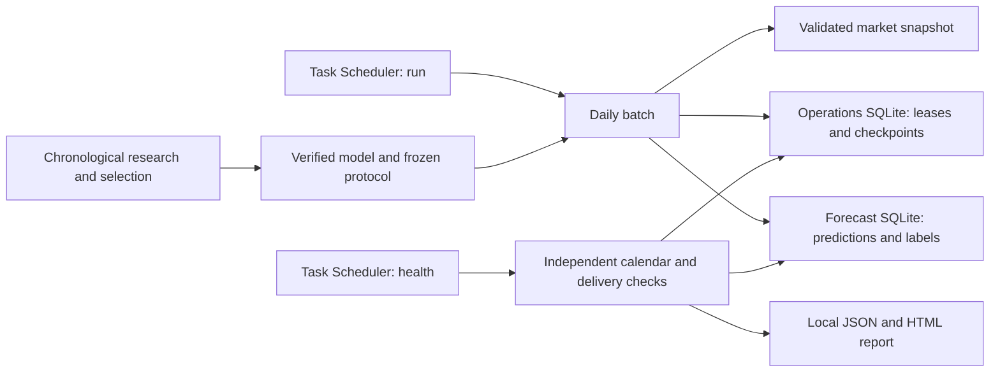

# Architecture

The cleanup deliberately uses a **strangler-style migration** rather than moving every historical module at once.

## Compatibility layer

The existing root scripts remain the supported legacy entry points:

- stock_prediction_deep_learning.py
- stock_prediction_deep_learning_inference.py
- stock_prediction_numpy.py
- stock_prediction_lstm.py

This prevents old commands, notebooks and external links from breaking.

## Maintained research layer

The quant_forecast_lab package contains dependency-light components that can be tested without downloading market data or starting TensorFlow:

- config.py — shared model/target compatibility rules;
- evaluation.py — forecast error, direction and naive-relative skill;
- experiment.py — data hashing and runtime provenance;
- arena.py — cross-asset/horizon out-of-sample comparison and HTML reporting;
- validation.py — chronological expanding-window folds;
- uncertainty.py — distribution-free conformal intervals;
- backtest.py — explicit transaction-cost-aware diagnostics;
- benchmark.py — model comparison;
- reproducibility.py — deterministic seed setup;
- cli.py — research utilities.

## Prospective batch lane

The research lane produces a verified model and a frozen evaluation protocol.
Batch inference consumes these artifacts without training or automatic model
promotion. Daily delivery and prospective measurement have separate acceptance
criteria from research selection and predictive advantage.

- `batch_config.py` validates pinned code/artifacts and computes due sessions.
- `operations.py` owns transactional job leases, stage history and active pointers.
- `daily.py` coordinates acquisition, delayed scoring and immutable recording.
- `health.py` reads the ledger/state independently; missing jobs need not run to
  be detected. Unique temporary files and bounded Windows rename retries protect
  concurrent publishers. HTML/JSON publish individually, not as one transaction;
  consumers should use JSON and check `checked_as_of`.
- `recovery.py` validates release switches and single-database backup/restore.
- `batch_cli.py` exposes these operations; `scripts/` holds the scheduler wrapper
  and synthetic incident demo. No workflow server, broker or public endpoint.

The two SQLite stores are separate from immutable run directories. Restoring
both stores and their referenced files requires paused workers and a coordinated
procedure; the backup API does not make a multi-database atomic snapshot.
The batch lane reuses some internal shadow helpers; promoting these to explicit
public interfaces is deferred until another consumer justifies that refactor.
Read [OPERATIONS.md](OPERATIONS.md) for the installed pilot, failure handling and
the remaining host, data licensing, monitoring and recovery requirements.

Future refactors can move training, data and model implementations behind these stable interfaces one component at a time.

## Design rules

1. No test data may select epochs or hyperparameters.
2. Every price forecast should be compared with a last-observation baseline.
3. Probabilistic claims require calibration evidence.
4. A backtest is a diagnostic, not proof of deployable profitability.
5. Generated runs live outside source control.
6. Legacy entry points are preserved until an explicit major-version migration.
