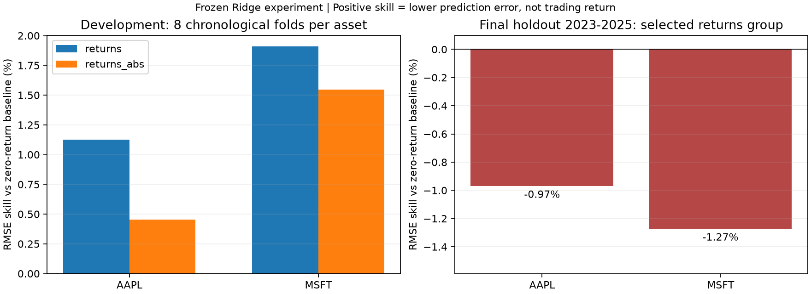

# Hiểu thí nghiệm StockForecasting từ dữ liệu đến kết luận

Tài liệu này giải thích phiên bản đã kiểm chứng ngày 12/11/2026. Bài toán chính
là dự báo **log-return của quan sát kế tiếp** từ lịch sử giá ngày của một mã.
Benchmark mới dùng Ridge; các mạng LSTM kế thừa mới được kiểm tra tương thích,
sửa biến đổi ngược và chạy smoke tối ưu hóa ngắn, chưa được benchmark thị trường.

## 1. Giá, return, forecast origin và target

Với giá `P[i]`, simple return là `P[i]/P[i-1] - 1`, còn log-return là
`r[i] = log(P[i]/P[i-1])`. Hai đại lượng gần nhau khi biến động nhỏ nhưng không
được dùng thay thế công thức khôi phục của nhau. Log-return được khôi phục bằng
`P_dự_báo = P_gốc × exp(r_dự_báo)`.

**Forecast origin** là thời điểm ta tạo dự báo bằng thông tin đã quan sát.
**Target** là đại lượng cần dự báo. **Horizon 1** nghĩa là quan sát kế tiếp;
không tự động có nghĩa ngày lịch kế tiếp hoặc phiên sàn đã được xác minh.

Ví dụ `P = [100, 110, 99, 108.9, 98.01]`:

~~~text
index:         0       1       2       3          4
giá:         100     110      99     108.9      98.01
return:              r1      r2      r3          r4
                                     ↑           ↑
                              origin đã biết   target
input lookback 2: [r3, r2]      model dự báo: r4
~~~

Đối chiếu `return_windows` trong [research.py](../quant_forecast_lab/research.py)
và test `test_window_targets_and_origin_history_are_aligned` trong
[test_research.py](../tests/test_research.py). Input mới nhất đứng trước;
`return_lag_1` ở ví dụ này là `r3`, không phải `r4`.

## 2. Vì sao cần baseline và Ridge?

**Baseline** là mốc so sánh đơn giản. Dự báo log-return bằng 0 tương ứng dự báo
giá giữ nguyên mức vừa quan sát. Nếu model phức tạp hơn không vượt mốc này,
chưa có bằng chứng rằng độ phức tạp đem lại giá trị cho bài toán đã xét.

**Ridge** là hồi quy tuyến tính có hình phạt với hệ số lớn; `alpha` điều khiển
mức phạt. **StandardScaler** chuẩn hóa từng feature bằng mean và scale học
từ training. Nó không được học các thống kê này từ validation hoặc test.

**Feature** là biến đầu vào. **Lookback L** là số return quá khứ đưa vào.
Nhóm `returns` có L biến; `returns_abs` có 2L biến, gồm L return có dấu và
L trị tuyệt đối tương ứng. Đây là một giả thuyết về thông tin độ lớn biến động,
không phải khẳng định thêm feature sẽ tốt hơn. Ridge có số hệ số gồm intercept
lần lượt là `L+1` hoặc `2L+1`; không áp dụng cách đếm này cho LSTM.

**Ablation** là so sánh có kiểm soát để biết một nhóm feature có đóng góp hay
không. Hai nhóm dùng cùng thời điểm dự báo, training targets và ngân sách thử.
Xem `feature_windows` và vòng chọn trial trong `run_offline_experiment`.

## 3. Chia thời gian và tránh leakage

**Leakage** xảy ra khi thông tin chưa có tại thời điểm cần dự báo ảnh hưởng
đến feature, preprocessing hoặc quyết định chọn model. Ví dụ: chuẩn hóa bằng
mean của toàn bộ dữ liệu hoặc chọn lookback sau khi xem kết quả final test.

Trong mỗi lần chạy con:

1. Training học scaler và hệ số Ridge; ADF/KPSS/ACF/PACF cũng chỉ xem training.
2. Validation chọn lookback và Ridge alpha từ danh sách đã định nghĩa.
3. Phần test của lần chạy con chấm model đã được chọn; không refit.

**Walk-forward** lặp quy trình trên với vùng training mở rộng theo thời gian.
Trong [walk_forward.py](../quant_forecast_lab/walk_forward.py), các phần test
ở development được dùng để chọn nhóm feature. Vì vậy chúng không phải final
holdout toàn cục. Mỗi nhóm có cùng các target và các fold không chấm trùng target.

Sau khi chọn nhóm feature, một model cuối được chọn lookback/alpha bằng
validation cuối trước năm 2023. Model giữ nguyên tham số suốt final holdout;
input được cập nhật bằng lịch sử đã quan sát tại từng origin. Đây là **rolling
origin với tham số cố định**, không phải tái huấn luyện model mỗi ngày.

Giá đã xảy ra trước một origin mới là input hợp lệ. Giá ở target tương lai
không được tham gia quyết định tại origin đó. Test thay đổi toàn bộ final
holdout kiểm tra lựa chọn feature, model và scaler vẫn giữ nguyên.

## 4. ADF, KPSS, ACF và PACF giúp gì?

**Tính dừng** liên quan đến sự ổn định của các đặc tính thống kê theo thời gian.
ADF có giả thuyết gốc về unit root; KPSS có giả thuyết gốc về tính dừng theo
specification đã chọn. Kết quả là bằng chứng có điều kiện, không phải chứng minh
model đúng hoặc chắc chắn dự báo được.

**ACF** đo tương quan tuyến tính giữa chuỗi và bản trễ của nó. **PACF** đo phần
tương quan tuyến tính còn lại sau khi kiểm soát các lag trung gian. Chúng giúp
đặt giả thuyết; validation mới đánh giá giá trị dự báo của cấu hình.

Không so sánh trực tiếp “số lag lớn hơn ACF”: lag là số bước, ACF là hệ số.
Một spike vượt dải pointwise 95% cũng có thể xuất hiện do khảo sát nhiều lag.
Runner lưu alpha/method/interval và không tự chọn lookback chỉ từ spike.
Xem [diagnostics.py](../quant_forecast_lab/diagnostics.py) và thư mục analysis
trong từng run; p-value không phải xác suất model đúng.

## 5. Các lỗi biến đổi ngược đã sửa

Với giá quan sát `100 → 110 → 99` và dự báo return bằng 0 ở hai origin, dự báo
một bước phải là `100, 110`. Cộng dồn từ 100 sẽ cho `100, 100`, mô tả một quy
trình khác với input lịch sử thực. `rolling_return_prices` giải quyết trường hợp
này; inference đệ quy thật vẫn nối tiếp lịch sử dự báo của chính nó.

Với giá `100 → 110 → 120`, xu hướng tuyến tính dự báo 130. **Residual** là phần
chênh giữa giá và xu hướng; residual bằng 0 phải khôi phục thành 130, không phải
120. Training và inference nay dùng chung `causal_trend`. Ở bước tương lai tiếp
theo, lịch sử chứa giá vừa dự báo; không được lấy giá tương lai thực.

**Epoch** là một lượt học qua training; **checkpoint** là trạng thái model được
lưu. Dừng sớm không tự đồng nghĩa lưu epoch tốt nhất. Callback đã bật
`restore_best_weights=True`; test callback mô phỏng hai lịch validation loss
trên model Keras thật (dừng vì patience và hết ngân sách epoch), sau đó lưu/nạp
lại model và đối chiếu dự báo. Smoke riêng kiểm tra một bước tối ưu hóa thật;
đó chưa phải một thí nghiệm huấn luyện thị trường.

Xem [reconstruction.py](../quant_forecast_lab/reconstruction.py),
[test_reconstruction.py](../tests/test_reconstruction.py) và
[test_training_contracts.py](../tests_runtime/test_training_contracts.py).

## 6. Đọc một run theo thứ tự nào?

Bắt đầu từ `summary.md`, sau đó `config.json`, `split_manifest.json` và
`selection.json` của run walk-forward. `fold_metrics.csv` cho thấy từng fold;
`development_predictions.csv` và `final_predictions.csv` chứa dự báo đã chấm.

Mỗi run con có analysis, `trials.csv`, `model_summary.txt`, `artifacts/model.json`,
`metrics.json`, predictions, hình và log. **Artifact** là file đầu ra có thể
dùng lại hoặc kiểm tra; model JSON chứa cả tham số scaler và thứ tự feature.
Nạp lại artifact được đối chiếu ở mọi test origin.

**Manifest** là bản kê trạng thái và artifact. **Checksum/hash** là dấu vân tay
nội dung file, giúp phát hiện file thay đổi. Hash không chứng minh nguồn dữ liệu
đúng hoặc phương pháp thống kê đúng. Manifest tổng còn ghi hash manifest con;
run lỗi giữ traceback và không được báo completed.

Đường dẫn local đã chạy và checksum snapshot được ghi trong
[báo cáo đo được](../benchmarks/results/2026-11-12-reference-ridge.json).
Dữ liệu giá và toàn bộ log được Git ignore; tải lại vendor có thể ra dữ liệu
đã sửa đổi. Muốn tái lập đúng snapshot cần giữ các CSV local đã dùng.

## 7. Kết quả và quyết định thực tế

Protocol được commit trước khi chạy: 2 mã, mỗi mã 8 development folds và 102
trial, tổng 204 trial. Final holdout có 752 target mỗi mã, từ 03/01/2023 đến
31/12/2025. Development có 124 quan sát cuối chưa đủ một fold, được công khai
trong manifest; chúng vẫn nằm trong dữ liệu trước final holdout.

| Mã | Nhóm được chọn trên development | Lookback cuối | Alpha cuối | Final RMSE | Baseline RMSE | RMSE skill |
| --- | --- | --- | --- | --- | --- | --- |
| AAPL | returns | 5 | 1 | 0.01625835 | 0.01610225 | -0.9694% |
| MSFT | returns | 1 | 10 | 0.01475966 | 0.01457421 | -1.2724% |

RMSE là căn trung bình bình phương sai số. Ở đây đơn vị là log-return, không
phải USD. `skill = 1 - RMSE_model/RMSE_baseline`; số âm nghĩa là model có sai số
lớn hơn baseline. Đây không phải tỷ suất lợi nhuận hoặc kiểm định ý nghĩa thống kê.

Development có cải thiện mô tả so với baseline, nhưng final holdout không giữ
được cải thiện đó. Nhóm abs cũng kém nhóm tối thiểu ở development của cả hai mã.
Quyết định: không giữ nhóm bổ sung cho cấu hình này, không promote Ridge như
model tốt hơn baseline và không tuning lại dựa trên final holdout đã xem.
Không suy rộng thành “mọi feature biến động đều vô ích” hay “ML không thể dự báo”.

## Bài tập của người học

Tính `r1, r2, r3, r4` cho chuỗi ở mục 1; viết input/target của
`return_windows(P, [4], 2)`; rồi tính giá dự báo nếu model trả log-return bằng 0.
Tự kiểm tra: input có thứ tự `[r3,r2]`, target là `r4`, giá dự báo là `108.9`.

Ba câu hỏi kiểm tra hiểu biết:

1. Vì sao được dùng giá phiên trước trong final holdout làm input, nhưng không
   được dùng kết quả toàn holdout để chọn feature?
2. Vì sao 109 test đạt chưa chứng minh model có lợi thế dự báo trên thị trường?
3. Vì sao tăng từ L lên 2L feature cần đánh giá riêng, ngay cả khi ACF có spike?

Đáp án đạt yêu cầu khi phân biệt được thời điểm có thông tin, phạm vi test kỹ
thuật với bằng chứng thực nghiệm, và giả thuyết tương quan với giá trị ngoài mẫu.
